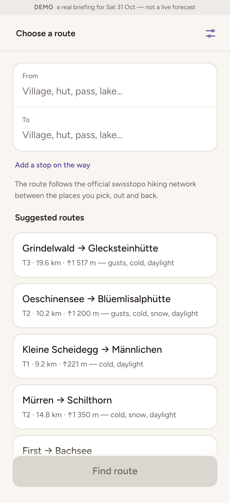
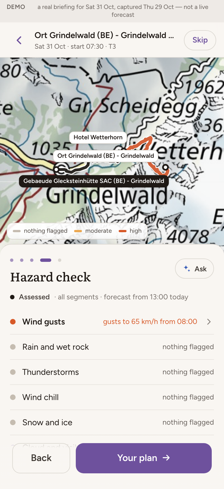
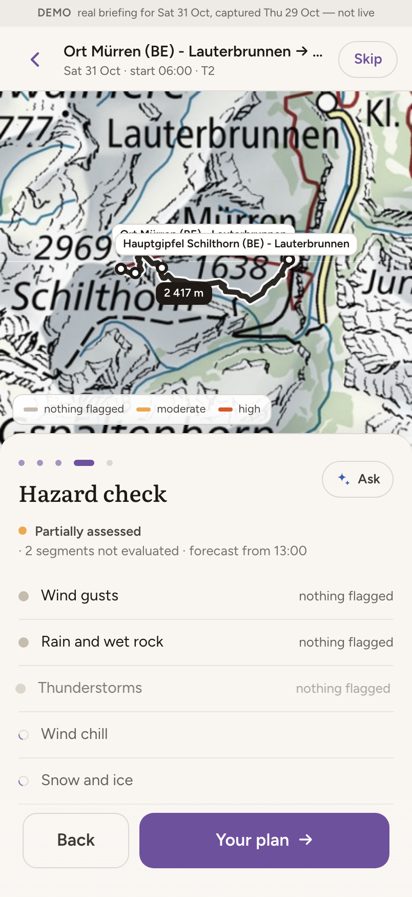
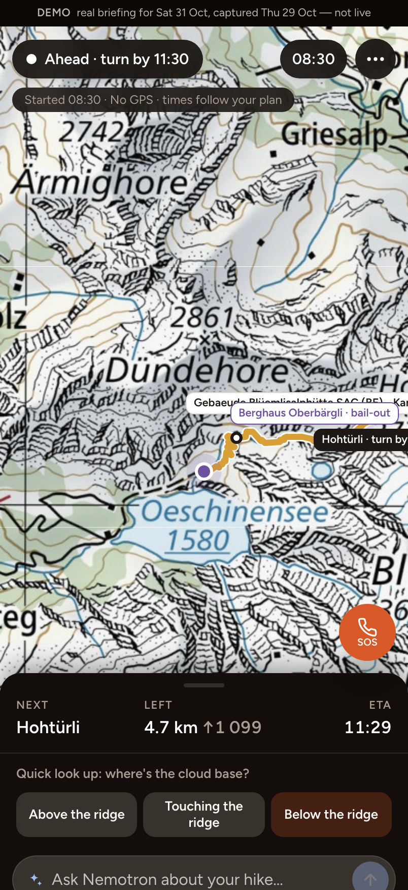

# Hiking safety assistant — static demo

A browsable copy of the [Hiking Safety Assistant](https://github.com/Swiss-ai-Weeks/hiking-safety-assistant),
built at the Swiss {ai} Weeks Agentic AI Hackathon in Geneva. It runs with no backend, so it can sit on
GitHub Pages and be opened from a link.

**Open it on a phone, or narrow the window.** The app is mobile-first.

<p align="center">
  
  
  
  
</p>

## What this is

The real app routes over swisstopo's official hiking network, pulls the MeteoSwiss ICON forecast for the
hours you would actually be up there, and runs seven hazard rules over the two together. That needs a
Python backend, a 64 MB trail graph and live forecasts, none of which a static host can run.

So the backend was run once, and its answers were saved. Everything you see — the routes, the stops and
their names, the walking times, the forecast at each stop, every hazard and every threshold — is real
output from the real engine for **Saturday 31 October 2026**, captured on **29 October**. Nothing on these
screens is hand-written sample text.

The browser still does its own share of the work, exactly as in the live app: it resolves each hazard's
severity at the hour *you* arrive. Move the start time and the route re-colours, the turnaround moves, and
what is flagged can change, with no request to anything.

## The six routes

| Route | Grade | Distance | Climb | Outcome | Hazards flagged that day |
|---|---|---|---|---|---|
| Grindelwald → Glecksteinhütte | T3 | 19.6 km | ↑1 517 m | assessed | gusts, cold, daylight |
| Oeschinensee → Blüemlisalphütte | T2 | 10.2 km | ↑1 200 m | assessed | gusts, cold, snow, daylight |
| Kleine Scheidegg → Männlichen | T1 | 9.2 km | ↑221 m | assessed | cold, daylight |
| Mürren → Schilthorn | T2 | 14.8 km | ↑1 350 m | **partial** | cold, snow, daylight |
| First → Bachsee | T2 | 6.1 km | ↑169 m | assessed | cold, daylight |
| Griesalp → Rotstockhütte | T2 | 19.9 km | ↑1 271 m | assessed | cold, snow, daylight |

Mürren → Schilthorn came back **partial**: one stop's forecast was missing, so those legs are drawn as
*not evaluated* rather than quietly passed. That is the behaviour the app is built around — silence is
never an all-clear — and it is worth a look.

## What is simulated, and nothing else

1. **The day is pinned** to 31 October, the day that was captured. The date field is fixed, and a strip
   across the top of every screen says so.
2. **The clock is moved** to 08:30 that morning, so field mode has a hike in progress rather than one that
   ended weeks ago. Time then ticks normally.
3. **Ask is off.** The questions feature needs Nemotron on a GPU server, which a static site cannot host.
   The panel says so. Every figure the app shows came from the engine regardless: the model only ever
   phrased them.
4. **Route search is limited** to the six captured routes and the places on them. Routing any other pair
   needs the backend and its trail graph.

Map tiles still come live from swisstopo, so the map is the real national map.

## Run it locally

```bash
npm install
VITE_STATIC=1 npm run dev     # http://localhost:5173
VITE_STATIC=1 npm run build   # dist/, ready for any static host
npm test
```

## Deploying

Pushing to `main` builds and publishes through `.github/workflows/pages.yml`. In **Settings → Pages**, set
**Source** to **GitHub Actions**. The workflow serves the site under `/<repo>/`; for a `<user>.github.io`
repository, set `BASE_PATH: /` in the workflow instead.

## Refreshing the data

The data is a snapshot, and a snapshot ages. To take a new one, run the backend from the
[app repository](https://github.com/Swiss-ai-Weeks/hiking-safety-assistant) (it needs the trail import
described in its README), then:

```bash
python scripts/capture.py 2026-11-07 public/data   # the hike day, and where to write
npm run gen:routes                                 # rewrites src/demoRoutes.generated.ts
```

## Credit and licence

The application is the work of the Hiking Safety team — Mária Briza, Sylvain De Muynck, Saifudeen Hisham
Kolikara Mahin, Keith Willett and Yves Zieba — at the Agentic AI Hackathon, Geneva, September 2026. The
upstream repository carries no licence file, so the usual default applies: all rights reserved by its
authors. This copy exists to demonstrate that work.

How the system is built, in detail, is in the team's write-up: *Hiking safety assistant — how it works*.

**Decision support, not a verdict.** Even with a live forecast this app never says a route is safe. It
says what it checked, what it found, and what it could not check. In Switzerland, emergencies: **1414**
(Rega) or **112**.
